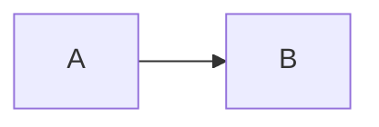

# mdwp — academic document generator

`mdwp` is a local Node CLI that turns a small project folder into a paginated,
APA-7-styled academic document (HTML and PDF). You edit source files; `mdwp`
compiles them with a headless Chrome/Chromium renderer.

## Prime rules

- **Edit sources, never generated output.** The source of truth is
  `contenido_fuente.md`, `portada.md`, `bibliografia.bib`,
  `documento-estilos.css`, `toc-engine.cjs` and `.mdwp/configuracion_metadatos.json`.
  `documento_formateado.html` and `documento.pdf` are rebuilt on every `mdwp build` /
  `mdwp pdf` and will overwrite manual edits.
- **After any source change, run a build** (`mdwp build <folder>` or
  `mdwp pdf <folder>`) so the HTML/PDF reflects it. The editor (`mdwp open`) is
  only needed when a human wants the GUI.
- **Do not hand-edit `.mdwp/configuracion_metadatos.json`** unless you know the
  exact key: it is the editor's state and embeds images as base64 (often >1 MB).
  Prefer `mdwp open` for page size, margins, TOC levels and other settings.
- `.mdwp/toc.json` is generated by builds. Customize the TOC through
  `toc-engine.cjs`, not `toc.json`.
- Output file names are fixed: `documento_formateado.html` and `documento.pdf`.

## CLI

```
mdwp new [nombre]       Create a project (cover, content skeleton, styles, bib, TOC engine)
mdwp build [carpeta]    Compile to documento_formateado.html (and refresh .mdwp/toc.json)
mdwp pdf [carpeta]      Compile and also write documento.pdf
mdwp open [carpeta]     Open the Electron editing GUI
mdwp help               Show help
```

- With no folder, the current directory is used.
- `build`/`pdf` need Chrome or Chromium. Detection order: `$WP_CHROME`,
  `/usr/bin/google-chrome`, `/usr/bin/google-chrome-stable`,
  `/usr/bin/chromium`, `/usr/bin/chromium-browser`, `/usr/bin/microsoft-edge`.
  If none exists mdwp exits with: `No se encontró Chrome/Chromium. Instálalo o
  define WP_CHROME.`
- `mdwp new` refuses to write into a folder that already contains
  `.mdwp/configuracion_metadatos.json`.
- The YAML `title` is used as the document title; the folder name is the fallback.
- The detection list above is Linux-only, so on Windows set `WP_CHROME` to
  `chrome.exe`/`msedge.exe` explicitly. `mdwp new`, `build` and `pdf` work on
  Windows; `mdwp open` does not (it spawns the extensionless
  `node_modules/.bin/electron`).

## Project anatomy

| Path | Role | Edit? |
|---|---|---|
| `contenido_fuente.md` | Body: YAML front matter + Markdown content | **Yes — main file** |
| `portada.md` | Cover: CSS block + Markdown block | **Yes** |
| `bibliografia.bib` | BibTeX entries | **Yes** |
| `documento-estilos.css` | Document styles, referenced from YAML | **Yes** |
| `toc-engine.cjs` | Project-owned TOC renderer (Node module) | **Yes, to customize TOC** |
| `apa.csl` | APA 7 citation style asset | Rarely |
| `.mdwp/toc.json` | Generated TOC data (refreshed by build) | No (generated) |
| `.mdwp/configuracion_metadatos.json` | Editor settings + base64 images | Via `mdwp open` |
| `.mdwp/unemi-tmp.docx` | Reference DOCX style template | No |
| `.mdwp/icon.png`, `cover.png`, `footer-wp.png` | Cover/margin/footer artwork | Replaceable |
| `img/` | Figures referenced from content | **Yes** |
| `documento_formateado.html`, `documento.pdf` | Build output | No (generated) |
| `sections/` (optional) | Files pulled in with `@include(...)` | **Yes** |

## Content syntax

### YAML front matter

`contenido_fuente.md` starts with a fenced YAML block. `mdwp new` generates it;
keep these keys:

```yaml
---
title: "S10-TAREA_2"
format:
  docx:
    reference-doc: .mdwp/unemi-tmp.docx
  html:
    css: documento-estilos.css
bibliography: bibliografia.bib
csl: apa.csl
lang: es
nocite: "@*"
toc: true
cover: true
---
```

- `toc: true` → automatic table of contents page.
- `cover: true` → include `portada.md` as the cover page.
- `bibliography:` → activates the bibliography and points at the `.bib`.
- `format.html.css:` → stylesheet applied to the output.
- `nocite: "@*"` → keep all `.bib` entries available to the reference list.

The YAML parser is minimal: scalars, quoted strings, `[a, b]` arrays and nested
keys only. Avoid advanced YAML.

### Markdown body

Standard GitHub-flavored Markdown, plus mdwp extensions:

```markdown
# Heading 1        (APA level 1, centered bold)
## Heading 2       (APA level 2, flush left bold)
### Heading 3      (APA level 3, bold italic)

Normal paragraph text. Inline **bold**, *italic* and `code` work.
Blank lines separate paragraphs.

- list item
- another item

| Col A | Col B |
|---|---|
| a | b |
```

Raw HTML is allowed and preserved:

```html
<br>

```

### Page breaks, bibliography, TOC

Put each directive on its own line:

```markdown
[PAGEBREAK]

# Bibliografía

[BIBLIOGRAPHY]
```

- `[PAGEBREAK]` — forced page break.
- `[BIBLIOGRAPHY]` — insert the formatted reference list here.
- `[TOC]` — insert an inline table of contents at this position (in addition to,
  or instead of, the automatic `toc: true` page).

### Citations (APA / citeproc syntax)

Every key must exist in `bibliografia.bib`.

```markdown
Parenthetical:      [@garcia2020]
Multiple:           [@garcia2020; @lopez2021]
Suppress author:    [-@garcia2020]
With locator:       [@garcia2020, p. 10]
Multiple + locator: [@garcia2020, pp. 27-30; @lopez2021, chap. 2]
Narrative:          @garcia2020            -> García (2020)
Narrative locator:  @garcia2020 [p. 10]    -> García (2020, p. 10)
```

### Figures

Plain image (no APA figure label):

```markdown

```

APA figure with numbered caption — requires an attribute block after the image:

```markdown
{#fig-diagram}

{#fig-diagram width=70% align=center note="Nota explicativa."}
```

- Attribute keys: `id`, `width`, `align` (`left|center|right`), `wrap`
  (`none|left|right|square`), `caption`, `note`.
- Without a `{#...}` block no "Figura N" label is generated.
- URL-encode spaces in paths: `img/Network%20topology.png`.
- A numbered figure becomes one `div.wp-rendered-figure` holding the caption
  (`Figura N` + title), the image and the optional note. The paginator keeps
  that wrapper **atomic**: the caption never lands on a different page than its
  image (fixed in the engine; see "Engine internals").
- A figure taller than the whole page cannot fit and is clipped. Give tall
  screenshots an explicit `width=60%`/`70%` so they shrink to the page.

### Tables with captions

A table immediately followed by `: Caption {#tbl-id}` becomes a numbered APA table:

```markdown
| Criterio | LAN | WAN |
|---|---|---|
| Alcance | Pequeño | Amplio |

: Comparación entre LAN y WAN {#tbl-comparacion}
```

The id must start with `tbl-`.

### Includes (split large documents)

```markdown
@include("sections/introduccion.md")
@include("sections/desarrollo.md")
```

- Paths are relative to the file containing the directive.
- Included files have their own YAML front matter stripped.
- Includes may nest; paths cannot escape the project root.

### Math, code, fenced divs, colors

```markdown
Inline math: $E = mc^2$
Display math:

$$
\int_0^1 x^2\,dx
$$

\( a+b \) and \[ a+b \] also work.

```python
print("fenced code with language")
```



::: {.timeline-section}
Content wrapped in a real `<div class="timeline-section">` for custom CSS.
:::

Colored text: [color:#002E45](texto)   [bg:#FEF08A](texto)   [#FF6600](texto)
```

## Cover (`portada.md`)

The cover is a two-block file. `mdwp new` writes a working template; edit the
Markdown, keep the markers.

```markdown
<!-- mdwp:cover-css -->
body { font-family: Arial, sans-serif; color: #002E45; }
.cv-page { height: 100%; display: flex; justify-content: center; align-items: center; }
/* ... */
<!-- /mdwp:cover-css -->

<!-- mdwp:cover-markdown -->


# FACULTAD DE CIENCIAS DE INGENIERÍA
# CARRERA DE TECNOLOGÍAS DE LA INFORMACIÓN Y COMUNICACIÓN EN LINEA.

## TEMA:
Título del trabajo

## GRUPO:
Nombre Uno
Nombre Dos

## CURSO:
Asignatura

## PROFESOR:
Ing. Docente, Mgti

## FECHA:
[FECHA]

## PERIODO:
Abril 2026 - Julio 2026

<br>
<br>

# MILAGRO-ECUADOR
<!-- /mdwp:cover-markdown -->
```

- `[FECHA]` → today's date in `es-EC`; `[DATE]` → `en-US`.
- In cover Markdown, a single newline becomes a line break (unlike the body).
- Set `cover: false` in the content YAML to suppress the cover.

## Bibliographies

`bibliografia.bib` is parsed by a small BibTeX reader. Recognized entry types map
to: `book` (default), `article`, `web`/`online`/`misc`, `thesis`
(`phdthesis`/`mastersthesis`), `inproceedings`/`incollection`/`conference`/`inbook`,
`report`/`techreport`.

Read fields include: `author`, `year` (or `date`), `title`, `publisher`,
`journal`/`journaltitle`, `volume`, `number`/`issue`, `pages`, `url`/`howpublished`,
`urldate`, `school`/`institution`, `type`, `address`, `booktitle`, `editor`, `doi`,
`edition`.

```bibtex
@article{garcia2020,
  author       = {García, Ana and Pérez, Luis},
  title        = {Título del artículo},
  journaltitle = {Revista de Ejemplo},
  year         = {2020},
  volume       = {12},
  number       = {3},
  pages        = {45--67},
  doi          = {10.1000/ejemplo}
}

@book{lopez2021,
  author    = {López, María},
  title     = {Título del libro},
  year      = {2021},
  publisher = {Editorial}
}

@online{unemi2025,
  author  = {{UNEMI}},
  title   = {Página institucional},
  year    = {2025},
  url     = {https://www.unemi.edu.ec},
  urldate = {2025-09-01}
}
```

Workflow: add entries to `bibliografia.bib` → cite with `[@key]` in the body →
keep `[BIBLIOGRAPHY]` where the list should appear. If there is no
`[BIBLIOGRAPHY]` and the YAML has `bibliography:`, mdwp appends the reference list
on a new page at the end.

## Styles and TOC

- `documento-estilos.css` is referenced from the YAML (`format.html.css`). It is
  project-owned; edit it freely and rebuild.
- `toc-engine.cjs` is executed at build time. It exports a function (or
  `{ renderTOC }`) receiving:
  ```js
  { title, pages: [{ page, titles: [{ title, page, level }] }], inline: [] }
  ```
  and returns one HTML string per TOC page. `mdwp build` fills the TOC slots with
  this output. Edit this file to change the TOC layout/design; `toc.json` is
  regenerated but the engine is never overwritten.
- The default engine declares `renderTOC.metrics = { headerHeight, entryHeight }`
  to keep pagination in sync.
- Page size, orientation, margins, headers/footers and TOC levels live in
  `.mdwp/configuracion_metadatos.json`; changing them is best done with
  `mdwp open`.

## Engine internals (only when a build misbehaves)

`mdwp` is a Node CLI wrapping a React/Vite renderer; the source lives at
`~/Documents/Projects/Document Editors/markdown/desktop` (the `mdwp` on PATH
runs `bin/wp.cjs`).

- `bin/wp.cjs` serves the **built** app in `dist/` on a local port and drives
  headless Chrome with `puppeteer-core`. It waits for the renderer to POST
  `documento_formateado.html` (a `__wpCompileDone` signal), then prints the PDF.
- Pagination is computed in the renderer, not by CSS: see
  `src/components/DocumentPreview.tsx`. It walks the content's top-level blocks,
  measures each against the page height and splits paragraphs, tables, code and
  lists. A `div` with 2+ element children is split by its direct children —
  except wrappers explicitly excluded (e.g. `.wp-rendered-figure`, `<figure>`),
  which are kept whole.
- **Editing the engine needs a rebuild:** change `src/` and run
  `npm run build:renderer` (Vite) to regenerate `dist/`, otherwise `mdwp build`
  keeps using the old bundle. Never edit `dist/` by hand.
- `documento_formateado.html`/`documento.pdf` are produced by the running app;
  a CSS-only change in the project (`documento-estilos.css`) is enough for
  styling, but changing *how pages are split* is an engine change.

## Workflows

### Edit an existing project
1. `cd` into the project folder (the one containing `contenido_fuente.md`).
2. Read `contenido_fuente.md`, `portada.md`, `bibliografia.bib`.
3. Edit the source files (body, cover, references).
4. Run `mdwp build .` or `mdwp pdf .`.
5. Verify the build log; inspect `documento_formateado.html` / `documento.pdf`
   only to confirm output.

### Create a new project
```bash
mdwp new "S12-TAREA_1"
cd "S12-TAREA_1"
# edit contenido_fuente.md and portada.md
mdwp pdf .
```

### Add a section with evidence
1. Create `img/` if needed and place screenshots there.
2. Add headings and `{#fig-file width=80%}` in the body
   (set `width=` on tall screenshots so they fit on one page).
3. Insert `[PAGEBREAK]` before the evidence section if it must start a new page.
4. Rebuild. Each caption stays on the same page as its image.

### Add references
1. Add BibTeX entries to `bibliografia.bib`.
2. Cite with `[@key]` / `@key` in the body.
3. Keep a `# Bibliografía` + `[BIBLIOGRAPHY]` section (the scaffold already has it).
4. Rebuild.

## Troubleshooting

| Symptom | Cause / fix |
|---|---|
| `No se encontró Chrome/Chromium` | Install Chromium/Chrome or set `WP_CHROME=/path/to/chrome`. |
| Images missing in the PDF | Use project-relative paths (`img/x.png`), URL-encode spaces, rebuild with `mdwp pdf`. |
| Citation shows literally (`[@key]`) | Key typo or the entry is not in `bibliografia.bib`. |
| Reference list empty | No entries in `bibliografia.bib`, or no `[BIBLIOGRAPHY]` and no YAML `bibliography:`. |
| TOC wrong / extra page | Edit `toc-engine.cjs` (and its `metrics`); `toc.json` is regenerated by the build. |
| Figure title on a different page than its image | The paginator split the `.wp-rendered-figure` wrapper. It is fixed to stay atomic; if it still happens the running `dist/` is stale — rebuild the engine (`npm run build:renderer`). |
| Tall screenshot cut off at the bottom | The figure is taller than the page. Pass `width=60%`/`70%` in the `{#...}` block so it scales down. |
| Build reports stale output | A previous build failed; fix the errors in the log and rebuild. The old HTML is not reused. |
| Cover not shown | Content YAML has `cover: false`, or `portada.md` markers were removed. |
| Edits don't appear | You edited the generated HTML/PDF instead of the sources, or forgot to rebuild. |

## Do / Don't

- Do edit `contenido_fuente.md`, `portada.md`, `bibliografia.bib`,
  `documento-estilos.css` and `toc-engine.cjs`.
- Do run `mdwp build`/`mdwp pdf` after edits.
- Do keep the YAML front matter and the `<!-- mdwp:cover-* -->` markers intact.
- Do use `@include("...")` to split long documents.
- Don't hand-edit `documento_formateado.html`, `documento.pdf` or `.mdwp/toc.json`.
- Don't rewrite `.mdwp/configuracion_metadatos.json` by hand; use `mdwp open`.
- Don't rename `unemi-tmp.docx` or `apa.csl` without updating the YAML.
